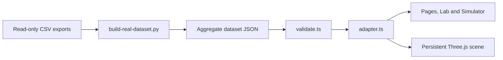

# Meridian · WWI Supply Chain Intelligence

**Live site: https://omarrez2.github.io/meridian-intelligence/**

Meridian is an interactive, bilingual analytics experience built for a **DEPI Graduation Project**. It analyses the supply chain of Wide World Importers: sales, fulfilment, purchasing, inventory, suppliers and customers. Everything is presented through a single cinematic Three.js instrument, in English and Arabic, with light and dark themes.

> **Analytical status:** the dataset reconciles exactly with the team's SQL benchmarks. The team's findings are still *awaiting formal approval*, and the website's own analysis is labelled *not reviewed by the team*. Decision Simulator results are scenario arithmetic, not forecasts or causal estimates.

## What's inside

| Route | What it covers |
|---|---|
| `#/` | **Atlas**: the opening narrative and the shared instrument |
| `#/overview` | **Overview**: context, objectives, scope and approach |
| `#/observatory` | **Observatory**: six analytical domains with shared filters, drill-downs, metric definitions and provenance |
| `#/journey` | **Data journey**: source-to-analysis stages and validation |
| `#/insights` | **Insights**: the team's findings and the website's own analysis, each with evidence, limits and a recommendation |
| `#/lab` | **Analytics Lab**: statements labelled *finding*, *calculation*, *hypothesis* or *recommendation*, computed when the page loads |
| `#/simulator` | **Decision Simulator**: price, volume, supplier-shock, recovery and stock-cover scenarios on the recorded gross profit (described below) |
| `#/engineering` | **Engineering**: data model, quality controls and technical notes |
| `#/team` | **Team**: the six members, their roles and contributions |
| `#/present` | **Presentation Mode**: 16 keyboard-controlled bilingual slides, including the Lab and a live Simulator slide |

The Decision Simulator works as follows:
- **Exact profit bridge:** each scenario is shown as a bridge whose steps add up exactly to the change in gross profit.
- **Assumption load:** the share of that change that rests on an assumption rather than a decision.
- **Break-even:** the volume loss at which a price change stops paying.
- **Sensitivity:** tornado and sweep charts showing which assumptions move the result most.
- **A/B comparison:** two scenarios side by side, shareable by URL.
- **Separate ledgers:** gross profit, purchase spend, inventory capital and holding cost are never added together.

## Data and method

- **Source:** the dataset is aggregated from read-only CSV exports of Microsoft's *WideWorldImporters* OLTP sample, covering January 2013 to May 2016.
- **What ships:** only the aggregate JSON. No source extracts, database files or Power BI files.
- **No personal data:** customer labels are pseudonyms, and the data contains no customer names, contacts or addresses.
- **Validation:** `validate.ts` checks the data contract and reconciles thirteen benchmarks, using the same metric code as the Observatory.
- **Limits:** inventory is a single end-of-period snapshot, and 2016 is a partial year.

See [Data architecture](docs/data-architecture.md) and the [Export contract](docs/export-contract.md).

## Technology

| Area | Tools |
|---|---|
| Application | TypeScript, Vite, native browser APIs (no UI framework, no backend) |
| Scene | Three.js with custom GLSL: one persistent GPU particle morph shared by every route |
| Motion | GSAP. It respects `prefers-reduced-motion` and has a pause control. |
| Charts | d3-array, d3-scale and d3-shape with project chart components |
| Quality | Node test runner, Playwright Core, axe-core, simulated-device performance profiles |



## Run locally

```sh
npm ci
npm run dev        # http://127.0.0.1:5173
npm test           # data, Lab and Simulator tests
npm run build      # production bundle in dist/
```

Browser checks run against the dev server: `scripts/smoke.mjs`, `check-keyboard.mjs`, `check-a11y.mjs` and `check-data-modes.mjs`. `scripts/perf.mjs` runs against the preview build.

## Deployment

Every push to `main` builds the site with `VITE_DEPLOY_TARGET=github-pages` (base `/meridian-intelligence/`) and deploys it with GitHub Actions. See [deployment notes](docs/deployment/github-pages.md).

## Known limitations

- Browser coverage: Chrome on Windows, plus emulated phones. Safari, Firefox, screen readers and physical devices have not been verified.
- The archived design-direction pages (`#/directions`) are English-only.

## Third-party notices

| Component | Licence |
|---|---|
| WideWorldImporters sample database (Microsoft) | MIT |
| three.js | MIT |
| d3-array, d3-scale, d3-shape | ISC |
| GSAP | GreenSock Standard "no charge" licence |
| Cormorant Garamond, IBM Plex Sans (and Arabic and Condensed), Amiri, via Fontsource | SIL Open Font License 1.1 |
