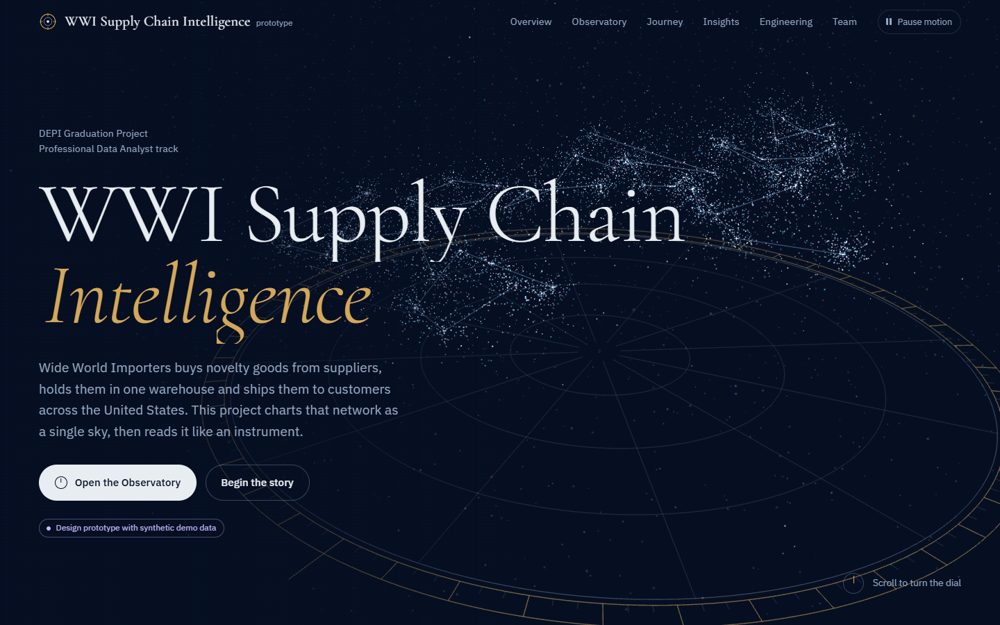
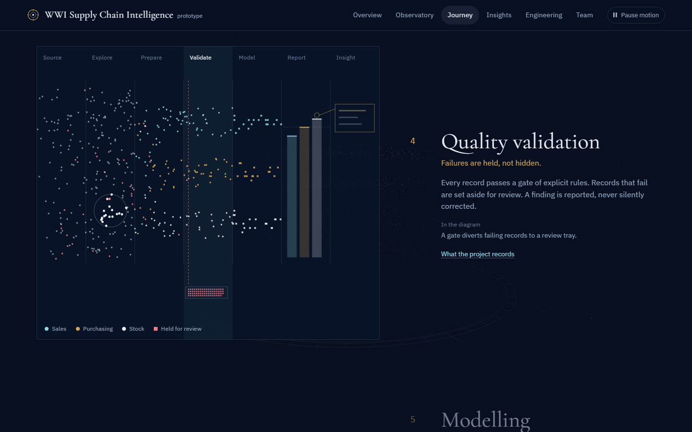
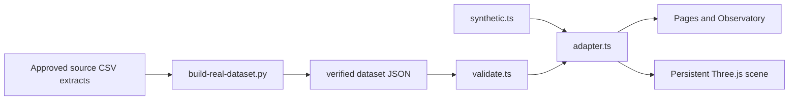

# WWI Supply Chain Intelligence

**A private preview of an interactive supply-chain analytics experience for the DEPI Graduation Project.** The site brings sales, fulfilment, purchasing, inventory, supplier and customer analysis into a single bilingual, cinematic interface.

> **Preview status:** the current verified dataset is source-reconciled, not approved for public publication. Metric definitions, the website's derived findings and product-family groupings still need team approval. The repository is intended to remain private; the site is not deployed and retains `noindex`.

**Suggested release:** `v0.5.0-preview` (not yet tagged)

## At a glance

- One persistent Three.js instrument morphs between territory constellations, supply routes, data strata and the time dial.
- The Observatory brings six analytical domains together with shared filters, drill-downs, metric definitions and explicit data provenance.
- English and Arabic interfaces include RTL layout, light and dark themes, keyboard-accessible Presentation Mode and reduced-motion support.
- Verified and synthetic datasets are isolated by a typed adapter. A rejected or missing verified dataset never falls back to demo values.
- No application backend or database connection; the site runs as a static client-side experience.

## Selected views

| Atlas | Data journey |
|---|---|
|  |  |

These are curated design captures, not current analytical output. The Atlas capture visibly labels its synthetic demo state; do not treat screenshot values as project results.

## Experience

| Route | What it covers |
|---|---|
| `#/` | **Atlas** — the opening narrative and shared instrument |
| `#/overview` | **Overview** — project context, objectives, scope and approach |
| `#/observatory` | **Observatory** — sales, orders, purchasing, inventory, suppliers and customers |
| `#/journey` | **Data journey** — source-to-analysis stages and validation |
| `#/insights` | **Insights** — analytical reasoning, caveats and findings awaiting approval |
| `#/engineering` | **Engineering** — data model, quality controls and illustrative technical material |
| `#/team` | **Team** — bilingual profiles, responsibilities and project resources |
| `#/present` | **Presentation Mode** — a keyboard-controlled, bilingual slide experience |
| `#/directions` | **Design studies** — archived visual directions and their sub-pages |

## Data and analytical method

The current verified view was built from the original sixteen-export, read-only CSV handoff for the Wide World Importers OLTP sample. The website builder reads twelve of those exports: the source tables needed for its sales, fulfilment, purchasing, inventory and customer aggregates. The other four exports are not inputs to this website dataset and are not shipped. The source extracts, database files and Power BI files are not included. The website ships the resulting aggregate JSON; it does not query SQL Server or load a backend. The checked-in dataset was not regenerated for this release preparation.

The dataset covers January 2013 through May 2016. Invoice lines form the sales facts; order lines and order-level delivery records form separate fulfilment measures; purchase orders record expected spend and completed receipts; inventory is a single end-of-period snapshot; and customer-month aggregates support customer metrics. Source customer segments are retained, while product families are website-defined keyword groupings rather than source dimensions. Customer labels are pseudonyms; the dataset contains no customer names, contacts or addresses.

The dataset is marked `reconciled` and includes thirteen benchmark rows. The runtime validator checks the contract and reconciles those benchmarks using the same metric implementations used by the Observatory. This is not equivalent to team approval: all registry definitions remain `proposed`, and the website's own findings are explicitly unreviewed. Revenue and profit are source-derived measures, not claims about future performance. The partial final calendar year must be interpreted accordingly.

See [Data architecture](docs/data-architecture.md) and the [Export contract](docs/export-contract.md) for the current pipeline, field grains, validation and caveats.

## Technology

| Area | Tools |
|---|---|
| Application | TypeScript, Vite, native browser APIs |
| Shared visual scene | Three.js and custom GLSL |
| Motion | GSAP |
| Charts | D3 array, scale and shape utilities with project chart components |
| Fonts | Self-hosted Fontsource packages |
| Browser checks | Playwright Core and axe-core |

There is no UI framework, backend, telemetry service or remote font dependency. The site uses hash-based routes, and language, theme, motion and data-mode preferences persist in the browser.

## Architecture



Only the adapter chooses between datasets. `validate.ts` checks structure, dates, types, references, duplicates and benchmark reconciliation. `measures.ts` is shared by the Observatory and validator; `derive.ts` prepares data for the scene and page previews. A development-only fixture seam tests missing and invalid states without changing the shipped dataset.

## Run locally

Use Node.js with npm, open a terminal in the project root, then:

```sh
npm ci
npm run dev
```

Open `http://127.0.0.1:5173`. The server binds to loopback only.

On Windows PowerShell environments that block the `npm.ps1` shim, run the same commands as `npm.cmd ci` and `npm.cmd run dev`.

| Command | Purpose |
|---|---|
| `npm run typecheck` | TypeScript check |
| `npm run build` | Type-check and create the production bundle in `dist/` |
| `npm run preview` | Serve the production bundle locally |
| `npm test` | Data contract, metric and architecture tests |
| `node scripts/smoke.mjs` | Route, language and theme smoke checks (dev server required) |
| `node scripts/check-data-modes.mjs` | Verified/demo and unavailable/invalid-state browser checks (dev server required) |
| `node scripts/check-keyboard.mjs` | Keyboard and focus checks (dev server required) |
| `node scripts/check-a11y.mjs` | axe-core accessibility checks (dev server required) |
| `node scripts/check-contrast.mjs` | Approximate text-contrast checks |
| `node scripts/perf.mjs` | Simulated-browser performance profile of the preview build |

`npm run build` does not publish or deploy anything. Python-based dataset regeneration is a separate, approved-data workflow; see the export contract before using it.

## Reported pre-release QA

The project reports these results for the latest local QA run on 24 November 2026:

| Check | Reported result |
|---|---|
| TypeScript and production build | Passed |
| Data validation tests | 54/54 |
| Browser data-mode checks | 82/82 |
| Route smoke checks | 32/32 |
| Keyboard checks | 29/29 |
| axe-core accessibility | Zero violations across 34 tested scenes |
| Responsive overflow | None at the tested viewport sizes |
| Performance | Passed under the documented simulated profiles |

These are reported project results, not a fresh run for this repository-preparation change. Browser/device coverage is Chrome emulation on one Windows machine, not physical-device testing.

## Current limitations and release gates

- Team approval is still needed for metric semantics, website-derived findings and product-family definitions.
- Permission for public publication of individual profiles, portrait images and profile links remains to be confirmed. They are retained for this private preview; do not make the repository public or deploy the site until permissions are resolved.
- Safari, Firefox, screen readers and physical phones/tablets have not been verified.
- The dataset includes a partial final year and a point-in-time inventory snapshot; it is not a continuous inventory history.
- The archived design-directions pages are English-only.
- GitHub Pages is **not configured or enabled**. A repository base path and a reviewed deployment workflow are still required; see below.

## GitHub Pages assessment

Hash routing is compatible with static hosting and avoids server-side route rewrites. Font files are imported through Vite and the dataset is included by Vite's JSON glob, so both can be emitted into a static bundle. Team portrait URLs already use `import.meta.env.BASE_URL`.

The project currently builds for the site root: `vite.config.ts` does not set a project-site `base`, while the HTML references the favicon and social image with root-absolute paths. Before Pages, configure and test the base path for `/wwi-supply-chain-intelligence/`, confirm generated URLs for the entry bundle, fonts, JSON and portraits, and set canonical/Open Graph URLs only after the final site URL is approved. A future Actions workflow should deploy only the reviewed `dist/` artifact with least-privilege Pages permissions and a controlled `main` trigger. Confirm that the account plan supports Pages for a private repository. No workflow, Pages setting or deployment has been created.

## Documentation

- [Data architecture](docs/data-architecture.md)
- [Export contract](docs/export-contract.md)
- [Design system](docs/design-system.md)
