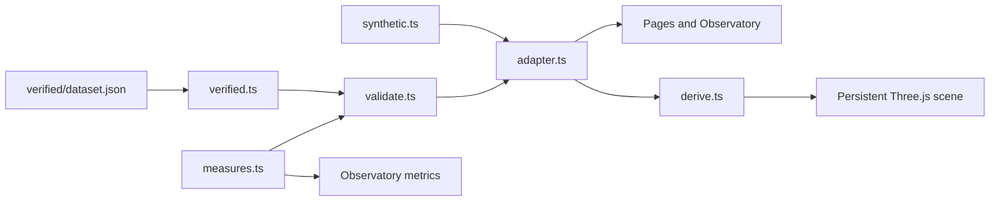

# Data architecture

This document describes the current implementation in `src/data/`. The website has a checked-in, source-reconciled dataset and a separately generated synthetic demo dataset. It has no database connection or application backend.

## Data flow

Only `adapter.ts` imports the verified loader or the synthetic module. Pages, analysis and the scene consume data through `getDataset()`. The verified loader requires exactly one JSON file matching `src/data/verified/*.json`; zero files produce an unavailable state, multiple files are rejected, and an invalid file is never partially shown. The verified view never falls back to synthetic values.

## Modules

| Module | Responsibility |
|---|---|
| `types.ts` | Dataset, provenance, fact and metric contracts |
| `mode.ts` | Reads the requested data mode and preserves it in hash-route navigation |
| `adapter.ts` | The single page-facing entry point; selects verified or synthetic data |
| `verified.ts` | Loads and validates the one verified JSON file; exposes the development-only QA fixture seam |
| `validate.ts` | Checks schema, types, dates, ranges, keys, references, coverage and reconciled benchmarks |
| `synthetic.ts` | Seeded demo dataset, imported only through the adapter |
| `metrics.ts` | Bilingual metric registry; definitions are still marked `proposed` |
| `measures.ts` | Shared implementations for Observatory values and benchmark recomputation |
| `derive.ts` | Produces the sky data layer and page previews from the selected dataset |
| `analysis.ts` | Website-derived analysis used by Home, Insights and Presentation Mode |
| `components/datastate.ts` | Shared loading, unavailable, invalid and provenance UI |

## Current verified dataset

`src/data/verified/dataset.json` is the current verified slot and the default data view. Its provenance status is `reconciled`, with coverage from January 2013 through May 2016, in USD. It contains aggregated measures and reference labels—not the source CSV extracts, database files or Power BI model. Customer labels are pseudonyms (`Customer <id>`); customer names and contact fields are not present.

The export contract is version 2. It contains:

| Collection | Grain or role |
|---|---|
| `months`, `years` | Consecutive month index and covered calendar years |
| `territories`, `categories` | Source customer segments and website-defined product families |
| `facts` | Month × segment × family sales and order-line measures |
| `orderFacts` | Month × segment order, backorder and confirmed-delivery measures |
| `purchaseOrders` | Purchase order spend, line count, receipt status, outer packs and expected lead time |
| `suppliers` | Supplier label, source group and reference lead time |
| `items` | Item label, family, stock snapshot and lifetime sales/demand aggregates |
| `customers`, `customerFacts` | Pseudonymous customer key/segment and month × customer aggregates |
| `benchmarks` | Optional scoped KPI values and sources for reconciliation |
| `missing` | Known source gaps, shown with the dataset context |

The `facts` and `orderFacts` use different grains intentionally. A customer order can contain items from several product families, so order counts are not repeated across family cells. Purchase-order lead time and receipt status are null for orders that were not fully received in the source snapshot. Inventory is a snapshot, not a time series.

## Source preparation and analytical rules

The current build helper is `scripts/build-real-dataset.py`, not the former `build-verified-dataset.mjs` converter. It reads a folder of source CSVs and writes the aggregate JSON plus a reconciliation report. The code opens twelve named tables: invoice lines, invoices, order lines, orders, customers, customer categories, stock items, stock holdings, purchase orders, purchase-order lines, suppliers and supplier categories. Existing project records describe a sixteen-export read-only handoff; the website builder uses the twelve exports needed for its published aggregate collections. The other four source exports are not read by this builder and are not included in the website dataset. Their names are not part of the current builder contract, so they are not inferred here. The source extracts are not included in this repository.

The builder creates monthly aggregates. Customer segments come from the source customer categories, ordered by invoiced revenue. Product families are website-defined keyword groups applied to the source item names in first-match order; they are not a source dimension. Revenue is quantity × unit price on invoice lines; recorded profit comes from line profit. Unpicked units come from order-line quantity less picked quantity. Delivery punctuality compares confirmed invoice delivery dates with expected order delivery dates. Purchase-order spend is ordered outer packs × expected price per outer; only fully received purchase orders contribute a completed lead time. Stock value uses quantity on hand × last cost price, and months of cover uses recent average item sales against the end-of-period stock snapshot.

The builder independently compares selected aggregates with the supplied team benchmark values before writing output. The runtime validator then recomputes each included benchmark with the same `measures.ts` functions used by the Observatory. A `reconciled` status indicates source/benchmark agreement; it does not imply approval of metric wording, family definitions or website-derived findings.

## Runtime states and routing

The data mode is read from the hash route, for example `#/observatory?data=demo`. The checked-in verified dataset is the default. Demo selection is also sticky across navigation until the visitor switches back to verified mode.

| State | Behaviour |
|---|---|
| Verified, ready | Shows the validated file and its provenance/status; validation warnings remain visible |
| Verified, unavailable | Shows an explicit missing-data state; no synthetic values are substituted |
| Verified, invalid | Rejects the file and reports validation errors; no values from it are shown |
| Demo, ready | Loads the seeded synthetic dataset and marks it as synthetic |
| Loading | Shows a loading state before values are available |

When the selected dataset changes, the route remounts under the transition veil and the persistent scene rebuilds its data layer. The dev-only `window.__WWI_VERIFIED_FIXTURE__` seam supports browser checks for ready, invalid and unavailable states without moving or editing the real JSON file. It passes through the same validator and is absent from production builds.

## Validation and tests

The validator rejects malformed structures, invalid status/provenance, invalid or non-consecutive coverage, invalid values and counts, duplicate keys, broken references, missing sales facts, and benchmark mismatches. It reports documented caveats and source inconsistencies as warnings rather than silently correcting data.

| Check | Command |
|---|---|
| Data contract, measures, registry and architecture guards | `node scripts/test-data.mjs` |
| Browser checks for verified/demo and missing/invalid states | `node scripts/check-data-modes.mjs` (dev server required) |

The latest reported pre-release results are 54/54 data tests and 82/82 browser data-mode checks. See the repository README for the full QA snapshot and current release gates.
